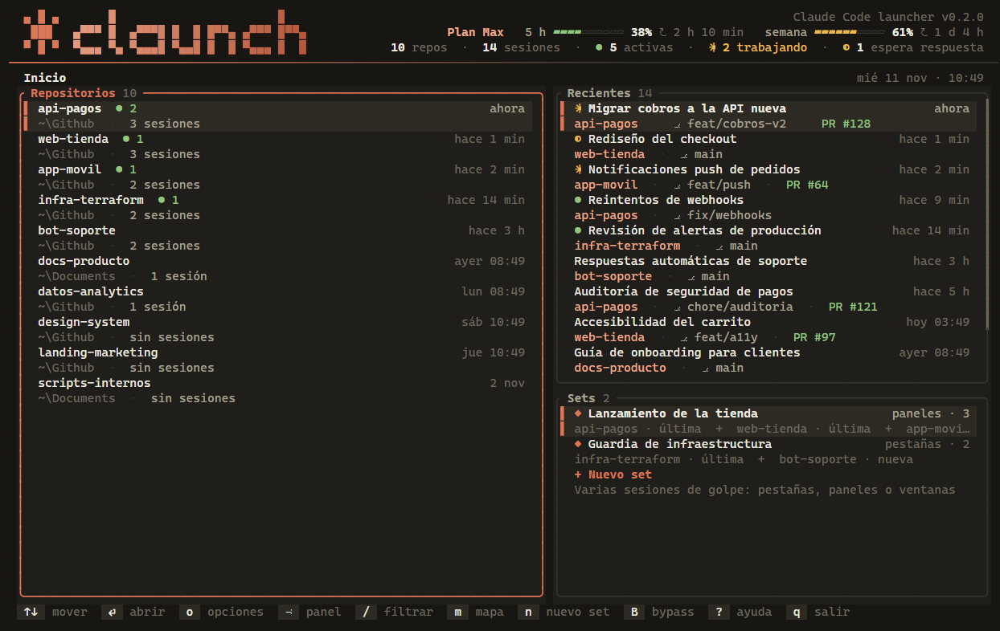

# ✳ claunch

**El centro de mando de Claude Code en Windows.** Todas tus sesiones, de todos
tus repos, en una sola pantalla: ábrelas en un clic, mira cuánto plan te queda,
qué sesiones están trabajando ahora mismo y cómo se hablan entre ellas.

[](https://github.com/Musul/Claunch-ClaudeCLI-Launcher/actions/workflows/ci.yml)




## Instálalo en un comando

Abre PowerShell y pega:

```powershell
irm https://raw.githubusercontent.com/Musul/Claunch-ClaudeCLI-Launcher/main/install.ps1 | iex
```

Listo: abre una terminal nueva y escribe `claunch` (o usa el perfil **claunch**
de Windows Terminal). Para actualizar, vuelve a ejecutar el mismo comando.

El instalador:

1. Revisa Git for Windows, Windows Terminal y Claude Code, y ofrece instalar lo
   que falte (winget y el instalador oficial de Claude).
2. Descarga `claunch.exe` de la última versión publicada y **verifica su SHA-256**
   antes de instalar nada.
3. Lo copia a `%USERPROFILE%\.local\bin`, lo añade a tu PATH y crea los perfiles
   «claunch» y «Claude · Git Bash» en Windows Terminal.

> **Mientras el repo sea privado** el comando de arriba no es accesible sin
> sesión. Con [GitHub CLI](https://cli.github.com) y una cuenta con acceso
> (`gh auth login`):
>
> ```powershell
> gh api repos/Musul/Claunch-ClaudeCLI-Launcher/contents/install.ps1 -H "Accept: application/vnd.github.raw" | Out-String | iex
> ```
>
> El instalador descarga entonces la versión con `gh`. Sin release accesible
> compila con `cargo`; desde un clon: `powershell -ExecutionPolicy Bypass -File .\install.ps1`.

Opciones (variables de entorno): `CLAUNCH_VERSION=v0.2.0` (versión concreta),
`CLAUNCH_FROM_SOURCE=1` (compilar), `CLAUNCH_YES=1` (sin preguntas),
`CLAUNCH_DRY_RUN=1` (probar sin instalar).

## Por qué claunch

| | |
|---|---|
| **Todas tus sesiones, ordenadas** | CLI, VS Code y Desktop juntas, agrupadas por repo y con la más reciente arriba. Título, rama, PR y último prompt de un vistazo. |
| **Tu plan, en vivo** | Barra de uso del plan (ventana de 5 h y semanal, con cuándo se reinicia) que se actualiza cada minuto. Sin abrir `/usage`. |
| **Qué está pasando ahora** | Junto a las sesiones activas, cuántas están **trabajando** y cuántas **esperan tu respuesta**. Cada sesión muestra su estado en la lista. |
| **Mapa de sesiones** (`m`) | Un grafo de quién habla con quién: sesiones de esta máquina y de otras (Remote Control), subagentes activos y los mensajes viajando en vivo del emisor al receptor. |
| **Tu espacio de trabajo en un comando** | *Sets*: abre varias sesiones de golpe en pestañas, paneles divididos o ventanas. `claunch open "Mi proyecto"` desde cualquier sitio. |
| **Sin pisar historiales** | Si la sesión ya está abierta en otra terminal o en VS Code, te ofrece abrirla como *fork*. |
| **Rápido** | Escrito en Rust, índice incremental: arranca al instante aunque tengas miles de sesiones. |

### El mapa de sesiones

Pulsa `m` y verás qué sesiones están conectadas, cuáles trabajan y por dónde
viajan los mensajes ahora mismo. A la derecha, el detalle de la sesión elegida:
con quién habla, cuántos mensajes y hace cuánto.


### Sets: tu espacio de trabajo en un comando


### Abrir con opciones

Destino, shell, reanudar o fork, modelo y permisos, con el comando `claude`
resultante a la vista antes de abrir.


> Las capturas usan datos de ejemplo: `claunch demo` abre la interfaz con
> ese mismo equipo ficticio, sin tocar nada real.

## Uso

```bash
claunch                      # la interfaz
claunch open "Mi proyecto"   # abre un set sin interfaz
claunch usage                # uso del plan en la terminal (--json para scripts)
claunch demo                 # la interfaz con datos de ejemplo (para mostrarla)
claunch bypass status        # estado del bypass global de permisos
claunch bypass on --yes      # activa permissions.defaultMode = bypassPermissions
claunch bypass off
claunch setup                # reinstala el ejecutable y los perfiles de Windows Terminal
claunch setup --uninstall    # borra los perfiles
```

### Pantallas

| Pantalla | Qué muestra |
|---|---|
| Inicio | Repositorios, Recientes (sesiones de todas las superficies) y Sets. Arriba, el uso del plan y las sesiones en vivo |
| Repo | «Nueva sesión» siempre primero y luego sus sesiones, más recientes primero |
| Mapa (`m`) | Sesiones y sus conexiones en la última hora, 24 h o 7 días (`t` cambia). Panel de detalle con estado, subagentes y mensajes por conexión |
| Set | Nombre, diseño (pestañas / paneles / ventanas), entradas y vista previa del diseño |

### Teclas

`↑↓`/`jk` mover · `⏎` abrir · `o` abrir con opciones · `⇥`/`←→`/`1 2 3` panel ·
`/` filtrar (⏎ abre) · `m` mapa · `n` nuevo set · `e` editar set · `d` borrar ·
`a` añadir sesión al set · `⇧↑↓` reordenar · `B` bypass global · `r` reescanear ·
`?` ayuda · `q` salir. Ratón: click, doble click y rueda.

### Estados en vivo

| Icono | Estado |
|---|---|
| `✳` (animado) | Trabajando: Claude está procesando un turno |
| `◐` | Espera tu respuesta o un permiso |
| `●` | Abierta e inactiva |
| `○` | Cerrada (en el mapa) |
| `◇` | Sesión de otra máquina (en el mapa) |

Salen de `~/.claude/sessions/<pid>.json`, donde Claude Code (CLI, VS Code y
Desktop) publica el estado de cada proceso; se valida que el proceso siga vivo.

### Opciones al abrir (`o`)

Destino (pestaña nueva, ventana nueva o esta terminal), shell (Git Bash por
defecto, PowerShell o CMD), modo (reanudar o fork), modelo, permisos y, para
sesiones nuevas, nombre (`-n`) y worktree (`-w`). Muestra el comando `claude`
resultante antes de abrir.

## Privacidad y seguridad

- **Uso del plan**: claunch lee el token OAuth que Claude Code guarda en
  `~/.claude/.credentials.json` y consulta `api.anthropic.com/api/oauth/usage`
  (lo mismo que hace `/usage`) una vez por minuto, compartida entre todas las
  ventanas de claunch (la última lectura, sin token, queda en
  `%LOCALAPPDATA%\claunch\usage.json`). El token solo vive en memoria durante la
  consulta: nunca se escribe, se registra ni se muestra, y claunch no lo renueva
  (si venció, abre `claude` y se renueva solo). Si la API pide esperar (429),
  claunch espera lo indicado y muestra el último dato atenuado. Es un endpoint no
  documentado: si cambia, la barra lo avisa y el motivo queda en el log.
  Para apagarlo: `show_usage = false` en la configuración.
- **Mapa**: se construye solo con archivos locales (`~/.claude/projects/*.jsonl`
  y `~/.claude/sessions/`). Del contenido de los mensajes entre sesiones no se
  guarda nada: solo quién habló con quién y cuándo.
- Ninguna otra conexión de red. Los archivos `.key` de `~/.claude/sessions` no se abren.

## Configuración

`%APPDATA%\claunch\config.toml` (la interfaz lo reescribe al editar sets):

```toml
[general]
scan_roots = ["~/Desktop", "~/Documents"]
default_shell = "git-bash"      # git-bash | powershell | cmd
default_target = "tab"          # tab | window | here
keep_shell_open = true          # al salir de Claude queda la shell en la carpeta
exit_after_launch = false
show_usage = true               # barra de uso del plan (consulta api.anthropic.com)
wt_profile = ""                 # GUID de perfil WT (setup pone «Claude · Git Bash»)
claude_command = []             # vacío = claude del PATH

[[set]]
name = "Mi proyecto"
layout = "panes"                # tabs | panes | windows
window = "new"                  # new | current

[[set.entry]]
repo = 'c:\Users\yo\Github\api-pagos'
session = "latest"              # new | latest | <uuid>
title = "API"
model = "opus"

[[set.entry]]
repo = 'c:\Users\yo\Github\web-tienda'
session = "new"
permission_mode = "plan"
```

## Bypass global de permisos

`B` en la interfaz o `claunch bypass on --yes` escribe
`permissions.defaultMode = "bypassPermissions"` en `~/.claude/settings.json`:
**todas** las sesiones nuevas ejecutan herramientas sin pedir permiso,
también en repos de producción. Cada cambio respalda el archivo como
`settings.json.bak-claunch-bypass-<AAAAMMDD>`, conserva orden y valores del
resto y verifica que solo cambió esa clave. Al desactivar restaura el modo
anterior. Para una sola sesión es más seguro `o` → Permisos.

## Cómo funciona

- **Índice**: lee `~/.claude/projects/*/<uuid>.jsonl` de forma incremental
  (solo los bytes añadidos, validados con una huella del final ya leído) y lo
  guarda en `%LOCALAPPDATA%\claunch\index.json`. Título: nombre puesto por el
  usuario > título IA > primer prompt.
- **Repos**: escanea `general.scan_roots` (por defecto Desktop, Documents,
  Downloads, source, Projects, dev, code, repos; profundidad 5) y une las
  carpetas con sesiones. Subcarpetas y worktrees se agrupan bajo su repo.
- **Mapa**: cada mensaje entre sesiones queda en el historial del emisor
  (`SendMessage`) y del receptor (`origin.kind = "peer"`); claunch los cruza, los
  cuenta sin duplicar y reconoce las sesiones por su tubería de mensajería, su id
  de Remote Control o su nombre.
- **Guarda contra doble apertura**: antes de reanudar mira si la sesión sigue
  viva o tuvo actividad hace menos de 90 s y ofrece fork, abrir igual o cancelar.
- **Unidad en minúscula**: arranca Claude con `c:\...`, igual que la extensión
  de VS Code, para que `/resume` vea las sesiones de ambas superficies (ver
  [docs/diagnostico-resume-mayusculas.md](docs/diagnostico-resume-mayusculas.md)).
- **Windows Terminal**: `wt -w 0 new-tab` (pestaña), `-w new` (ventana); los
  sets en paneles se reparten en columnas iguales.

## Desarrollo

Requiere Rust (toolchain MSVC) y Visual Studio Build Tools con la carga C++.

```bash
cargo test
cargo build --release
./target/release/claunch.exe setup
```

Para revisar el diseño sin abrir la interfaz:
`claunch snapshot <home|recents|sets|repo|map|map-week|options|new|guard|editor|editor-panes|editor-windows|help|bypass> 140x40 salida.html [--demo]`.
Con `--demo` usa los datos de ejemplo; así se generan las capturas de
`docs/img` (HTML → PNG con Edge sin interfaz:
`msedge --headless=new --window-size=1244,786 --screenshot=home.png salida.html`).

### Publicar una versión

1. Sube `version` en `Cargo.toml` (y `cargo build` para el `Cargo.lock`).
2. Commit en `main`, etiqueta y push: `git tag v0.2.0 && git push origin v0.2.0`.
3. El workflow `release` prueba, compila y publica `claunch-windows-x64.zip` con
   su `.sha256`. Desde ese momento el comando de instalación descarga esa versión.

### Archivos

- `src/data/`: índice de sesiones, repos, sesiones vivas, uso del plan (`usage.rs`) y grafo (`graph.rs`).
- `src/launch.rs`: argumentos de Claude, Windows Terminal y `claunch run`.
- `src/claude_settings.rs`: interruptor del bypass global.
- `src/ui/`: interfaz (ratatui + tachyonfx); `demo.rs`, los datos de ejemplo.
- `install.ps1`: instalador de un comando.
- `legacy/cc.sh`: la función `cc` de Git Bash anterior.
- `docs/`: capturas (`img/`), diagnóstico del problema de `/resume` y memoria asociada.
