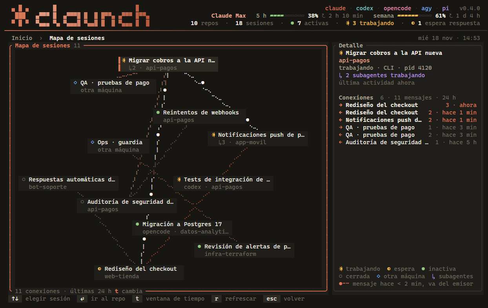
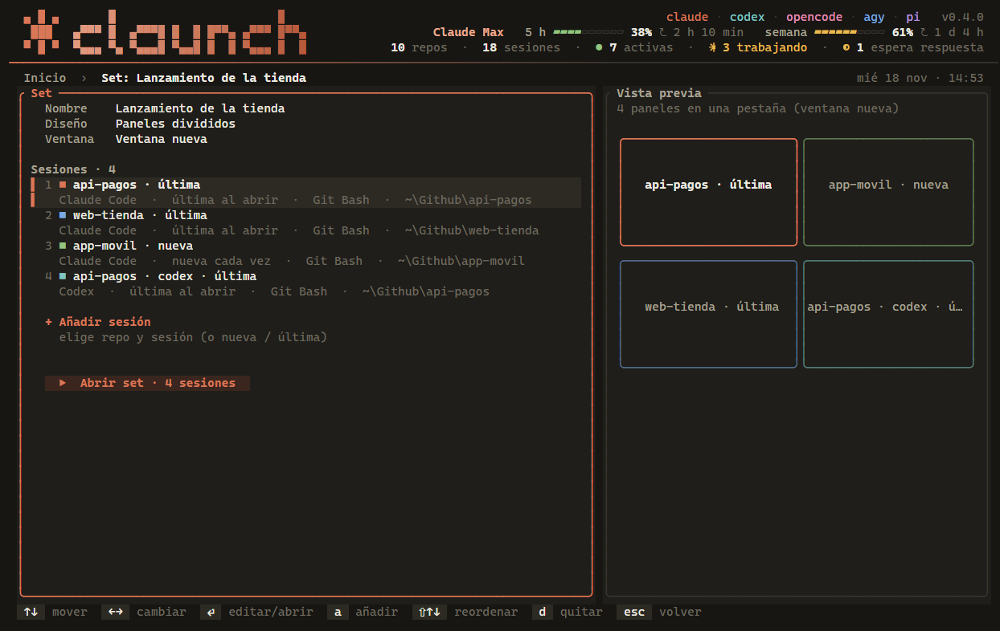
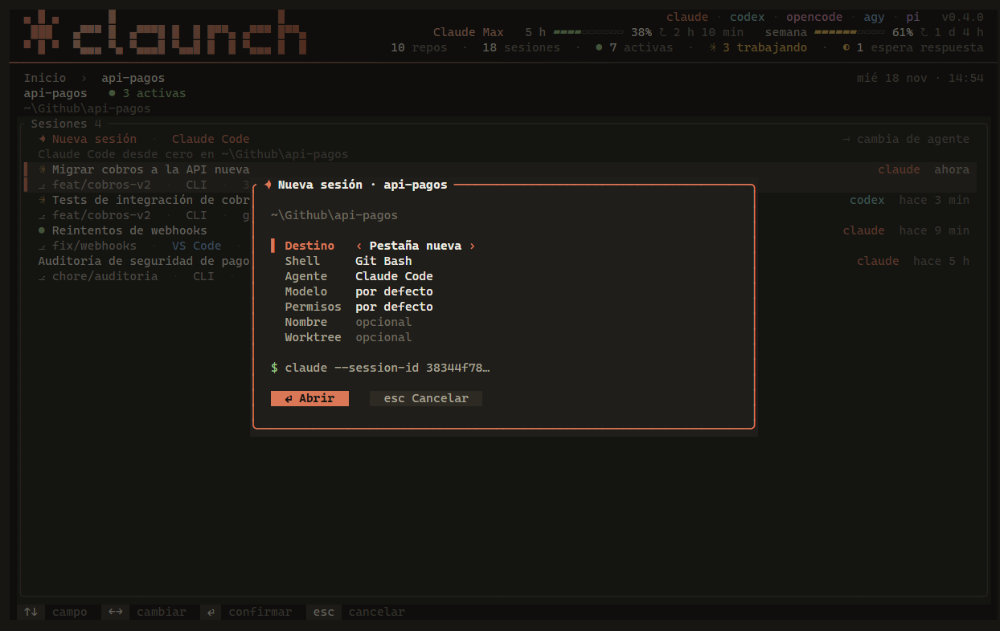

# ✳ claunch

**El centro de mando de tus agentes de código en Windows y Linux.** Claude Code,
Codex, opencode, Antigravity y Pi: todas tus sesiones, de todos tus repos, en una
sola pantalla. Ábrelas en un clic con el agente que quieras, mira cuáles están
trabajando ahora mismo y cuánto plan de Claude te queda.

[](https://github.com/Musul/Claunch-ClaudeCLI-Launcher/actions/workflows/ci.yml)


## Instálalo en un comando

**Windows**: abre PowerShell y pega:

```powershell
irm https://raw.githubusercontent.com/Musul/Claunch-ClaudeCLI-Launcher/main/install.ps1 | iex
```

**Linux**: abre una terminal y pega:

```bash
curl -fsSL https://raw.githubusercontent.com/Musul/Claunch-ClaudeCLI-Launcher/main/install.sh | sh
```

Listo: abre una terminal nueva y escribe `claunch` (en Windows también tienes el
perfil **claunch** de Windows Terminal). Para actualizar, vuelve a ejecutar el
mismo comando.

### Qué hace en Windows

1. Revisa Git for Windows y Windows Terminal y ofrece instalar lo que falte
   (winget).
2. Descarga `claunch.exe` de la última versión publicada y **verifica su SHA-256**
   antes de instalar nada.
3. Mira qué agentes tienes. Basta con uno; si no hay ninguno, ofrece el
   instalador oficial de Claude Code.
4. Lo copia a `%USERPROFILE%\.local\bin`, lo añade a tu PATH y crea los perfiles
   «claunch» y «Claude · Git Bash» en Windows Terminal.

> ¿Prefieres compilarlo tú? Desde un clon:
> `powershell -ExecutionPolicy Bypass -File .\install.ps1` (usa la release
> publicada o, con `CLAUNCH_FROM_SOURCE=1`, compila con `cargo`).

### Qué hace en Linux

Revisa tmux, descarga el binario estático para x86_64 (funciona en cualquier
distribución), **verifica su SHA-256**, mira qué agentes tienes (si no hay
ninguno, ofrece el instalador oficial de Claude Code) y lo deja en
`~/.local/bin`; si esa carpeta no está en tu `PATH`, ofrece añadirla a
`~/.bashrc` o `~/.zshrc`. En otras arquitecturas (ARM) compila con `cargo`.
Desde un clon: `sh install.sh`.

Dónde se abren las sesiones en Linux:

| Si claunch corre… | Pestaña nueva / set en pestañas | Set en paneles | Ventana nueva |
|---|---|---|---|
| **dentro de tmux** (recomendado) | ventana de tmux | paneles en una ventana (`tiled`) | ventana de tmux |
| en un escritorio, sin tmux | ventana del emulador | una ventana por sesión | ventana del emulador |
| por SSH, sin tmux | solo «Esta terminal» | — | — |

El emulador se elige solo: `general.terminal` si lo configuras, luego
`$TERMINAL`, el del escritorio (GNOME Terminal, Konsole, Xfce Terminal, MATE
Terminal) y después `x-terminal-emulator`, kitty, Alacritty, WezTerm, Ghostty,
foot, Terminator o xterm. En Linux no hay opción de shell: la sesión arranca con
`/bin/sh` y, si `keep_shell_open = true`, al salir del agente queda tu `$SHELL`.

### Opciones del instalador

Variables de entorno, iguales en Windows y Linux: `CLAUNCH_VERSION=v0.2.0`
(versión concreta), `CLAUNCH_FROM_SOURCE=1` (compilar), `CLAUNCH_YES=1` (sin
preguntas), `CLAUNCH_DRY_RUN=1` (probar sin instalar). En Linux van delante de
`sh`: `curl -fsSL … | CLAUNCH_YES=1 sh`.

## Agentes compatibles

claunch trabaja con los agentes que encuentre instalados; no hace falta tenerlos
todos. `claunch agents` dice cuáles ve, con qué ejecutable los lanza y cuántas
sesiones tiene cada uno.

| Agente | Ejecutable | Sesiones que lista | Reanudar | Fork | Al abrir puedes elegir |
|---|---|---|---|---|---|
| **Claude Code** | `claude` | CLI, VS Code y Desktop | `claude -r <id>` | ✓ | modelo, permisos, nombre, worktree |
| **Codex** | `codex` | CLI, VS Code y aplicación | `codex resume <id>` | ✓ | modelo, aprobación y sandbox |
| **opencode 2.x** | `opencode` | las de su base de datos | `opencode --session <id>` | — | permisos (`--auto`) |
| **Antigravity** | `agy` | CLI, aplicación e IDE | `agy --conversation <id>` | — | modelo, modo de permisos |
| **Pi** | `pi` | las de `~/.pi/agent/sessions` | `pi --session <archivo>` | ✓ | modelo, herramientas, nombre |

Lo que es solo de Claude Code: la barra de uso del plan, el mapa de mensajes
entre sesiones, el estado en vivo de sesiones abiertas fuera de claunch y el
bypass global de permisos.

Detalles de cada agente (qué se lee, qué flags se usan y qué no se puede hacer):
[docs/agentes.md](docs/agentes.md).

## Por qué claunch

| | |
|---|---|
| **Todas tus sesiones, ordenadas** | De los cinco agentes y de todas sus superficies (CLI, VS Code, aplicación de escritorio), agrupadas por repo y con la más reciente arriba. Título, agente, rama, PR y último prompt de un vistazo. |
| **El agente que quieras, donde quieras** | En cada repo, `⇥` elige con qué agente se abre la sesión nueva. Las existentes se reanudan con el suyo y con sus propias opciones (modelo, permisos, fork si lo admite). |
| **Tu plan de Claude, en vivo** | Barra de uso del plan (ventana de 5 h y semanal, con cuándo se reinicia) que se actualiza cada minuto. Sin abrir `/usage`. |
| **Qué está pasando ahora** | Junto a las sesiones activas, cuántas están **trabajando** y cuántas **esperan tu respuesta**. Cada sesión muestra su estado en la lista. |
| **Mapa de sesiones** (`m`) | Un grafo de quién habla con quién: sesiones de esta máquina y de otras (Remote Control), subagentes activos y los mensajes viajando en vivo del emisor al receptor. |
| **Tu espacio de trabajo en un comando** | *Sets*: abre varias sesiones de golpe, de uno o de varios agentes, en pestañas, paneles divididos o ventanas. `claunch open "Mi proyecto"` desde cualquier sitio. |
| **Sin pisar historiales** | Si la sesión ya está abierta, te ofrece abrirla como *fork* (si el agente sabe bifurcar). Con Claude lo detecta en cualquier terminal o en VS Code; con los demás, si la abrió claunch o tuvo actividad en los últimos 90 s. |
| **Rápido** | Escrito en Rust, índice incremental: arranca al instante aunque tengas miles de sesiones. |

### El mapa de sesiones

Pulsa `m` y verás qué sesiones están conectadas, cuáles trabajan y por dónde
viajan los mensajes ahora mismo. A la derecha, el detalle de la sesión elegida:
con quién habla, cuántos mensajes y hace cuánto. Los mensajes entre sesiones son
de Claude Code; las sesiones de otros agentes aparecen cuando están abiertas.



### Sets: tu espacio de trabajo en un comando



### Abrir con opciones

Destino, shell, agente, reanudar o fork, modelo y permisos, con el comando
resultante (`claude …`, `codex …`) a la vista antes de abrir.



> Las capturas usan datos de ejemplo: `claunch demo` abre la interfaz con
> ese mismo equipo ficticio, sin tocar nada real.

## Uso

```bash
claunch                      # la interfaz
claunch open "Mi proyecto"   # abre un set sin interfaz
claunch agents               # agentes detectados: ejecutable, datos y sesiones (--json para scripts)
claunch usage                # uso del plan de Claude en la terminal (--json para scripts)
claunch demo                 # la interfaz con datos de ejemplo (para mostrarla)
claunch bypass status        # estado del bypass global de permisos de Claude
claunch bypass on --yes      # activa permissions.defaultMode = bypassPermissions
claunch bypass off
claunch setup                # reinstala el ejecutable (y en Windows, los perfiles de Windows Terminal)
claunch setup --uninstall    # borra los perfiles de Windows Terminal
```

### Pantallas

| Pantalla | Qué muestra |
|---|---|
| Inicio | Repositorios, Recientes (sesiones de todos los agentes y superficies) y Sets. Arriba, los agentes disponibles, el uso del plan y las sesiones en vivo |
| Repo | «Nueva sesión» siempre primero (con el agente elegido) y luego sus sesiones, más recientes primero |
| Mapa (`m`) | Sesiones y sus conexiones en la última hora, 24 h o 7 días (`t` cambia). Panel de detalle con estado, subagentes y mensajes por conexión |
| Set | Nombre, diseño (pestañas / paneles / ventanas), entradas y vista previa del diseño |

### Teclas

`↑↓`/`jk` mover · `⏎` abrir · `o` abrir con opciones · `⇥`/`←→`/`1 2 3` panel ·
`⇥` en un repo: agente de «Nueva sesión» · `/` filtrar (⏎ abre; con sesiones de
varios agentes, su nombre también filtra) · `m` mapa · `n` nuevo set · `e` editar set · `d` borrar ·
`a` añadir sesión al set · `⇧↑↓` reordenar · `B` bypass global de Claude ·
`r` reescanear · `?` ayuda · `q` salir. Ratón: click, doble click y rueda.

### Estados en vivo

| Icono | Estado |
|---|---|
| `✳` (animado) | Trabajando: el agente está procesando un turno |
| `◐` | Espera tu respuesta o un permiso |
| `●` | Abierta e inactiva |
| `○` | Cerrada (en el mapa) |
| `◇` | Sesión de otra máquina (en el mapa) |

De dónde salen:

- **Claude Code** publica cada proceso (CLI, VS Code y Desktop) en
  `~/.claude/sessions/<pid>.json`, con su estado; claunch valida que el proceso
  siga vivo. Por eso ve también las sesiones abiertas fuera de claunch.
- **Los demás agentes** no publican sus procesos. claunch sabe que una sesión
  está abierta cuando la abrió él (deja un aviso mientras vive el proceso) y
  deduce si trabaja de lo último que el agente guardó en su historial. No
  distingue «espera un permiso» y no ve las sesiones abiertas por otra vía.

### Opciones al abrir (`o`)

Destino (pestaña nueva, ventana nueva o esta terminal), shell (solo Windows:
Git Bash por defecto, PowerShell o CMD), agente (sesiones nuevas), modo
(reanudar o fork), modelo, permisos y, para sesiones nuevas, nombre y worktree.
Solo aparecen las opciones que el agente admite. Muestra el comando resultante
antes de abrir.

## Privacidad y seguridad

- **Solo lectura**: claunch lee el historial que cada agente guarda en tu equipo
  (archivos `.jsonl` y bases SQLite, estas abiertas en solo lectura) para sacar
  título, carpeta, fecha y prompts. No modifica esos datos ni ejecuta los
  agentes para listar sesiones. Al leer una base, SQLite puede dejar junto a
  ella sus archivos auxiliares (`-shm`, `-wal`). La única credencial que lee es
  el token de Claude Code para la barra de uso (siguiente punto); de los demás
  agentes no abre ninguna.
- **Uso del plan** (solo Claude): claunch lee el token OAuth que Claude Code guarda en
  `~/.claude/.credentials.json` y consulta `api.anthropic.com/api/oauth/usage`
  (lo mismo que hace `/usage`) una vez por minuto, compartida entre todas las
  ventanas de claunch (la última lectura, sin token, queda en `usage.json`, en
  la carpeta de datos de claunch). El token solo vive en memoria durante la
  consulta: nunca se escribe, se registra ni se muestra, y claunch no lo renueva
  (si venció, abre `claude` y se renueva solo). Si la API pide esperar (429),
  claunch espera lo indicado y muestra el último dato atenuado. Es un endpoint no
  documentado: si cambia, la barra lo avisa y el motivo queda en el log.
  Para apagarlo: `show_usage = false` en la configuración.
- **Mapa**: se construye solo con archivos locales (`~/.claude/projects/*.jsonl`
  y `~/.claude/sessions/`). Del contenido de los mensajes entre sesiones no se
  guarda nada: solo quién habló con quién y cuándo.
- Ninguna otra conexión de red. Los archivos `.key` de `~/.claude/sessions` no se abren.

## Configuración

`%APPDATA%\claunch\config.toml` en Windows o `~/.config/claunch/config.toml`
en Linux (la interfaz lo reescribe al editar sets). Índice, log y uso del plan
van en `%LOCALAPPDATA%\claunch\` o `~/.local/share/claunch/`.

```toml
[general]
scan_roots = ["~/Desktop", "~/Documents"]
default_harness = "claude"      # agente de «Nueva sesión»: claude | codex | opencode | antigravity | pi
default_shell = "git-bash"      # git-bash | powershell | cmd (solo Windows)
default_target = "tab"          # tab | window | here (por SSH sin tmux: "here")
keep_shell_open = true          # al salir del agente queda la shell en la carpeta
exit_after_launch = false
show_usage = true               # barra de uso del plan de Claude (consulta api.anthropic.com)
wt_profile = ""                 # Windows: GUID de perfil WT (setup pone «Claude · Git Bash»)
terminal = []                   # Linux: ["tmux"], ["kitty"], ["gnome-terminal", "--"]…; vacío = autodetectar
tab_color = "#D97757"           # sin cambiarlo, cada agente usa su color

[harness.codex]                 # opcional, igual para claude, opencode, antigravity y pi
enabled = true                  # false: ni se indexa ni se ofrece
command = []                    # ejecutable y argumentos previos; vacío = el del PATH
home = ""                       # carpeta de datos del agente; vacío = la suya

[[set]]
name = "Mi proyecto"
layout = "panes"                # tabs | panes | windows
window = "new"                  # new | current

[[set.entry]]
repo = 'c:\Users\yo\Github\api-pagos'
session = "latest"              # new | latest | <id>
title = "API"
model = "opus"

[[set.entry]]
repo = 'c:\Users\yo\Github\api-pagos'
session = "new"
harness = "codex"               # sin indicar, Claude Code
permission_mode = "read-only"   # los modos dependen del agente
```

`session = "latest"` es la sesión más reciente **de ese agente** en la carpeta.
`claude_command` sigue valiendo como atajo de `[harness.claude] command`.

## Bypass global de permisos (Claude Code)

`B` en la interfaz o `claunch bypass on --yes` escribe
`permissions.defaultMode = "bypassPermissions"` en `~/.claude/settings.json`:
**todas** las sesiones nuevas de Claude ejecutan herramientas sin pedir permiso,
también en repos de producción. Cada cambio respalda el archivo como
`settings.json.bak-claunch-bypass-<AAAAMMDD>`, conserva orden y valores del
resto y verifica que solo cambió esa clave. Al desactivar restaura el modo
anterior. Para una sola sesión es más seguro `o` → Permisos. No afecta a los
demás agentes.

## Cómo funciona

- **Índice**: cada agente tiene su lector (`src/harness/`). Los que guardan un
  archivo por sesión (Claude, Codex, Pi) se leen de forma incremental (solo los
  bytes añadidos, validados con una huella del final ya leído); los que usan
  SQLite (opencode, Antigravity) se consultan en solo lectura y solo se vuelven
  a leer las sesiones que cambiaron. Todo queda en `index.json`, en la carpeta
  de datos. Título: nombre puesto por el usuario > título automático > primer prompt.
- **Repos**: escanea `general.scan_roots` (por defecto Desktop, Documents,
  Downloads, source, Projects, dev, code, repos y, en Linux, también projects,
  src, git, work y workspace; profundidad 5) y une las carpetas con sesiones.
  Subcarpetas y worktrees se agrupan bajo su repo.
- **Mapa**: cada mensaje entre sesiones de Claude queda en el historial del emisor
  (`SendMessage`) y del receptor (`origin.kind = "peer"`); claunch los cruza, los
  cuenta sin duplicar y reconoce las sesiones por su tubería de mensajería, su id
  de Remote Control o su nombre.
- **Guarda contra doble apertura**: antes de reanudar mira si la sesión sigue
  viva o tuvo actividad hace menos de 90 s y ofrece fork (si el agente lo
  admite), abrir igual o cancelar.
- **Sesiones en vivo**: las de Claude, por `~/.claude/sessions/<pid>.json`; las
  de los demás, por el aviso que deja `claunch run` en su carpeta de datos
  (`live/<pid>.json`). En ambos casos se comprueba que el pid siga vivo y que sea
  el mismo proceso, por su momento de inicio (Win32 en Windows, `/proc` en Linux).
- **Unidad en minúscula** (Windows, solo Claude): arranca Claude con `c:\...`, igual
  que la extensión de VS Code, para que `/resume` vea las sesiones de ambas
  superficies (ver
  [docs/diagnostico-resume-mayusculas.md](docs/diagnostico-resume-mayusculas.md)).
  Los demás agentes arrancan con la ruta como la da Windows (`C:\...`).
- **Windows Terminal**: `wt -w 0 new-tab` (pestaña), `-w new` (ventana); los
  sets en paneles se reparten en columnas iguales. Cada agente tiñe su pestaña
  de su color.
- **tmux** (Linux): `tmux new-window` por sesión; los sets en paneles,
  `split-window` + `select-layout tiled`.

## Desarrollo

Requiere Rust y un compilador de C (SQLite va incluido y se compila con el
proyecto). En Windows, toolchain MSVC y Visual Studio Build Tools con la carga
C++; en Linux, `build-essential` o equivalente.

```bash
cargo test
cargo build --release
./target/release/claunch setup     # claunch.exe en Windows
```

Para revisar el diseño sin abrir la interfaz:
`claunch snapshot <home|recents|sets|repo|map|map-week|options|new|guard|editor|editor-panes|editor-windows|help|bypass> 140x40 salida.html [--demo]`.
Con `--demo` usa los datos de ejemplo; así se generan las capturas de
`docs/img` (HTML → PNG con Edge sin interfaz:
`msedge --headless=new --window-size=1244,786 --screenshot=home.png salida.html`).

Para probar sin tocar tu configuración ni tu índice: `CLAUNCH_CONFIG=<archivo>`
y `CLAUNCH_DATA_DIR=<carpeta>`.

### Publicar una versión

1. Sube `version` en `Cargo.toml` (y `cargo build` para el `Cargo.lock`).
2. Commit en `main`, etiqueta y push: `git tag v0.2.0 && git push origin v0.2.0`.
3. El workflow `release` prueba y compila en Windows y Linux, y publica
   `claunch-windows-x64.zip` y `claunch-linux-x64.tar.gz` (estático, musl) con sus
   `.sha256`. Si uno falla no se publica nada. Desde ese momento los comandos de
   instalación descargan esa versión.

Para ensayar sin publicar (p. ej. tras tocar `release.yml`): Actions → release →
*Run workflow*. Compila, empaqueta y verifica los SHA-256, pero no crea la release.

### Archivos

- `src/harness/`: un módulo por agente (dónde guarda sus datos, cómo se indexan sus sesiones y con qué argumentos se lanza) y la interfaz común.
- `src/data/`: índice de sesiones, repos, sesiones vivas, uso del plan (`usage.rs`) y grafo (`graph.rs`).
- `src/launch.rs`: Windows Terminal y `claunch run`.
- `src/terminal.rs`: Linux, tmux o emulador gráfico.
- `src/claude_settings.rs`: interruptor del bypass global de Claude.
- `src/ui/`: interfaz (ratatui + tachyonfx); `demo.rs`, los datos de ejemplo.
- `install.ps1` / `install.sh`: instaladores de un comando (Windows / Linux).
- `legacy/cc.sh`: la función `cc` de Git Bash anterior.
- `docs/`: capturas (`img/`), agentes compatibles (`agentes.md`), diagnóstico del problema de `/resume` y memoria asociada.
